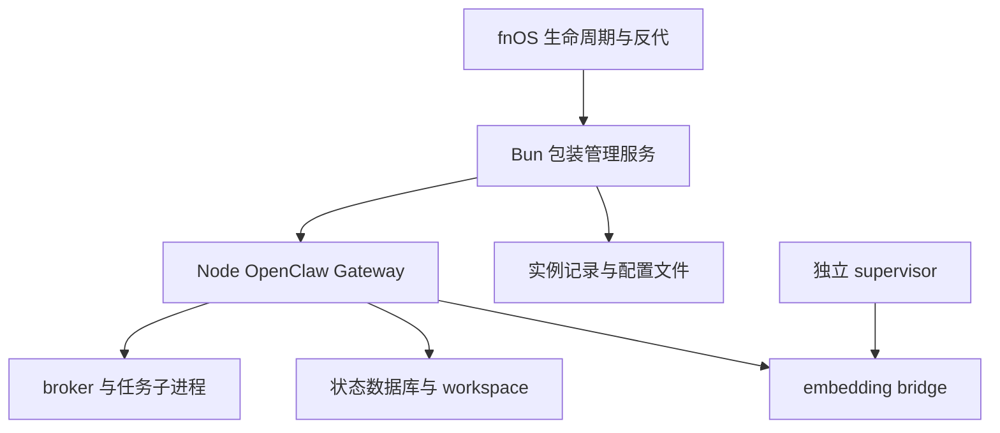

# 壳与 OpenClaw 的关系

## 分层

| 层 | 职责 | 不应混淆 |
|---|---|---|
| fnOS 平台 | AppCenter、权限、启动器、反向代理、共享依赖 | 平台依赖可能被多个应用共用 |
| trim.openclaw 壳 | Bun 管理服务、实例记录、UI/API、代理、配置种子、启动 core | 更新壳与更新 core 是两种操作 |
| OpenClaw core | Gateway、模型/工具、会话、调度、迁移 | 通常由壳 spawn，并非系统 systemd unit |
| 应用状态 | openclaw.json、数据库、凭据、workspace | 升级 npm 包不会替代状态迁移或完整备份 |
| 独立工具 | embedding bridge、supervisor、业务下载器 | Gateway 停止不代表它们停止 |

历史源码与回执显示：fnOS `cmd/main start` 设置平台 PATH 和应用环境后启动 Bun server；包装再解析实例、配置、CLI 路径并启动 Gateway。Bun `unref()` 不等于可证明整个子树能在父进程退出后安全存活。包装 stop、HTTP stop、Gateway 自己的信号退出是三条路径，不能互相代替。

观察到的包装 reconcile 定时器更新状态，不能据名称断言它必定自动重启 Gateway。启动先后和退出级联需按当前包确认；只有打开设置页与重启时间接近，不足以证明因果。

## 路径地图

`APP=trim.openclaw`；以下为案例布局，通过 readlink 解析，不硬编码卷号。多实例/系统托管模式可能改变 config/log/runtime 位置。

| 用途 | 稳定入口或相对位置 | 案例物理布局 |
|---|---|---|
| 生命周期 | `/var/apps/$APP/cmd/main` | 平台提供 |
| 壳目录 | `/var/apps/$APP/target` | `/volN/@appcenter/$APP` |
| 壳服务 | 壳目录 `/server/index.js` | Bun 运行 |
| CLI shim | 壳目录 `/bin/openclaw` | 设置 HOME/配置/PATH，再 exec CLI |
| 数据根 | `/var/apps/$APP/home/data`（需核实） | `/volN/@apphome/$APP/data` |
| core 工程 | 数据根 `/openclaw` | `package.json`、`bun.lock`、`node_modules` |
| core 包 | 工程 `/node_modules/openclaw` | `openclaw.mjs`、`dist/` |
| 应用 HOME | 数据根 `/home` | 不要依赖 passwd 中的默认 HOME |
| state | 应用 HOME `/.openclaw` | config、数据库、agents、私有工具 |
| workspace | 数据根 `/workspace` | MD、项目与本地工具 |
| 壳运行数据 | `/var/apps/$APP/var` | 常见 `/volN/@appdata/$APP`，info.log/app.pid |
| 壳监控数据库 | 数据根 `/monitor/monitor.sqlite` | 只通过管理接口/只读证据定位，不直接改库 |
| 包装代理 socket | 壳目录 `/trim.openclaw.sock` | 不等于 Gateway TCP 端口 |
| Gateway 日志 | 实例 logPath；案例为工程 `/gateway.log` | 另有 runtime 日志，见 05 |

历史 Gateway 端口为 49164、bridge 为 11434，均 loopback；端口可随实例/重装变化。不要将本例端口当默认。完整部署也可能引用数据根外的业务 state，备份必须显式纳入。

## 实际运行时比 PATH 更重要

平台 Bun：`/var/apps/bunjs/target/bin/bun`。平台 Node：`/var/apps/nodejs_v24/target/bin/node`。案例实际 Gateway 和 broker 用 state 下 `tools/cli-node/tools/node-v24.19.0/bin/node`；CLI shim 有 `tools/cli-node/tools/node/bin` 前置项。

同一文件可由多个 symlink 入口访问。比较 realpath、dev/ino 和 SHA，再判断是否冲突。`node --version` 只说明当前 shell 解析的 Node；`/proc/<当前PID>/exe` 才说明该进程实际加载路径。不要输出完整 cmdline/environ，里面可能有秘密。
